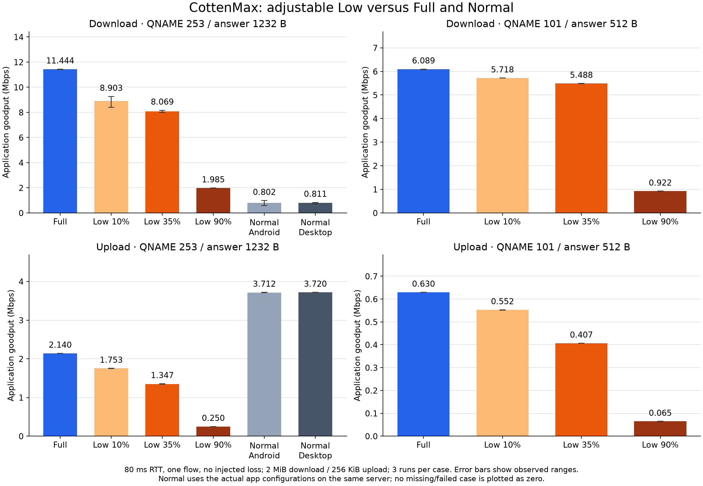
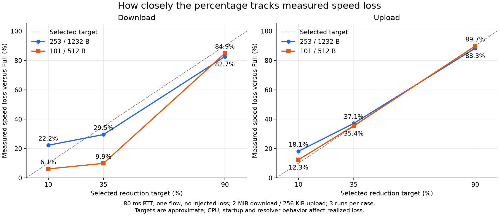

# CottenMax traffic profiles

CottenMax has a **Full** profile and an adjustable **Low** profile. Full remains
the unpaced profile. Low now targets a **35% bulk-speed reduction by default** (about 65%
of Full), configurable from **10% to 90%**. This replaces the original fixed
100-query/second prototype, whose measured 85–92% speed loss was too large.

```toml
TUNNEL_MODE = "cottenmax"
COTTENMAX_TRAFFIC_PROFILE = "low"
COTTENMAX_LOW_REDUCTION_PERCENT = 35
```

Select Full to remove the percentage pacing. The percentage stays saved for
later use. Reconnect after changing either setting. Omitted settings preserve
Full as the profile default and 35 as the saved Low target. Invalid profile names
or percentages outside 10..90 are rejected. CLI equivalents are
`--cottenmax-traffic-profile low --cottenmax-low-reduction-percent 35`.

## What the percentage means

| Reduction target | Intended retained bulk speed |
| ---: | ---: |
| 10% | About 90% of Full |
| 35% (default) | About 65% of Full |
| 90% | About 10% of Full |

These are targets, not exact guarantees. The controller uses authenticated
path RTT and the unscaled congestion windows as its Full-capacity reference;
it does not keep multiplying already-throttled throughput by the percentage.
It paces new queries and scales outstanding-query admission while preserving
normal congestion/loss estimation. A session gets a bounded warm start of at
most 32 verified-path query admissions to learn its congestion reference; lost
or unauthenticated replies cannot extend that allowance. Reference accounting
and bounded token credit are shared across domain engines. Credit covers a
short scheduling-jitter allowance and remains capped by the scaled flight.
A denied token cannot take ownership
of unsent ARQ data or start an unsent HELLO's timeout.

Real speed also depends on the resolver, response/name capacity, loss, CPU,
application behavior and startup. Short requests may differ substantially from
a sustained transfer. Near-zero-RTT CPU-bound paths do not provide an exact
unpaced CPU-capacity measurement, so a percentage must not be advertised as a
universal throughput SLA. An idle open domain can overestimate the shared
pacing reference; scaled flight gates still apply to each engine.

## Protections independent of the percentage

Selecting a 10% rather than 90% reduction does not restore aggressive connection
or resolver-discovery behavior:

| Control | Full | Low, at every percentage |
| --- | --- | --- |
| New tunnel stream attempts | Existing behavior | 2/second, burst 4, shared across domains |
| Engine TCP/DoT resolver connection attempts | Existing behavior | 2/second, burst 2, shared across domains |
| Initial configured resolver fanout | Existing behavior | Starts with 2; remaining endpoints remain eligible for paced checking |
| Discovery healthy-resolver target | Existing setting | At most 4 |
| Discovery concurrency / candidate pacing | Existing settings | At most 2 / at least 250 ms |
| Resolver address-range sampling | Existing opt-in setting | Disabled |
| Proactive upload-tail copies | Existing behavior | Disabled; ordinary retransmission remains active |
| Bulk pacing / flight admission | Existing behavior | Relative to the selected reduction target |

The former fixed 100 QPS, 32/8 flight ceilings, 64-stream ceiling and forced
1-second hold no longer apply. Low preserves the configured stream and hold
settings. Smaller configured windows remain the Full reference rather than
being raised. Authentication, encryption, MTU discovery, ARQ and optional FEC
remain active. Full keeps the original finite queues and safety/resource bounds.

The TCP/DoT connection cap does not govern connections managed internally by
DoH, HTTP/3 or DoQ. Their tunnel queries still use the percentage scheduler.
Pacing governs query creation; stalled transports can later flush queued work.
OS hostname lookups and recursive resolver retries are not tunnel query tokens.

## Client selection and server compatibility

Android and desktop feature branches add a Max-only Full/Low selector and a
Low-only 10..90% control, default 35. The value persists through settings,
profile links/import/export and runtime TOML. Normal behavior is unchanged;
Full retains the Low value without applying it. Reconnect to apply changes.

This is a client policy with **no new wire field or server protocol**. The same
server accepts Normal, Full Max and Low Max using the existing domain and key.
One client's policy does not constrain another client choosing Full. A provider-
wide ceiling would require operator-wide accounting for all users and services.

Resolver discovery originates at the client, not as outbound scanning by the
VPS. VPS destination connections come from authenticated stream requests;
Low therefore paces new stream attempts, including failed targets. No claim is
made that scanning caused a particular abuse notice or that this policy ensures
provider approval. Rate reduction also does not eliminate the bytes needed to
transfer the same content or guarantee a lower monthly bandwidth bill.

## Percentage measurements

The final production implementation is pinned at
`77bf87db28af6b64a4b6c404074982235272ed9b`. It was checked with actual production
client/server executables and byte-verified data. The server executable was
retained unchanged while Low/Full and the percentage targets changed.

The original timer-per-packet relay introduced unrequested callback reordering
and made Full downloads noisy. The final comparison uses ordered per-direction
delay queues at the same configured RTT/loss; the timer version and its data
are retained as historical experiments. Client receive-buffer sizing is now
bounded by its configured flight on default sockets; custom socket factories
retain their own settings. Receive overflow was not proven as the cause of the
noisy Full runs, so no such causal claim is made.

All **60 final transfer cases passed byte verification**. These are three
sequential randomized repetitions per case on Windows x64 / Ryzen 7 6800H /
Go 1.26.5: one flow, 80 ms RTT, no injected loss, 2 MiB incompressible download
or 256 KiB upload. Cold discovery, authentication and stream opening are outside
the payload timer; start signalling and receiver confirmation are inside it.
Wide means QNAME 253 / answer 1232 bytes; narrow means QNAME 101 / answer 512.

Median application goodput in Mbps:

| Path / direction | Full | Low 35% | Actual loss | Normal Android | Normal desktop |
| --- | ---: | ---: | ---: | ---: | ---: |
| Wide download | 11.444 | 8.069 | 29.5% | 0.802 | 0.811 |
| Wide upload | 2.140 | 1.347 | 37.1% | 3.712 | 3.720 |
| Narrow download | 6.089 | 5.488 | 9.9% | Not measured | Not measured |
| Narrow upload | 0.630 | 0.407 | 35.4% | Not measured | Not measured |

The 35% default is close to the requested reduction on wide downloads and both
upload shapes, but **does not track 35% on narrow downloads**. Its retained speed
there is about 90% of Full. This is an adaptive query/flight target, not a
calibrated measurement of how fast an unpaced client would run at that moment.
The congestion-window/RTT reference, payload/ACK scheduling and other bottlenecks
can leave excess reference capacity. These runs do not isolate their individual
contributions. Tight, network-independent throughput percentages would require
additional capacity estimation and validation; they are not implemented here.

Observed speed loss versus each matching Full median:

| Selected target | Wide download | Wide upload | Narrow download | Narrow upload |
| ---: | ---: | ---: | ---: | ---: |
| 10% | 22.2% | 18.1% | 6.1% | 12.3% |
| 35% (default) | 29.5% | 37.1% | 9.9% | 35.4% |
| 90% | 82.7% | 88.3% | 84.9% | 89.7% |





The goodput graph shows all observed ranges, not confidence intervals. For
example, wide Full download was 11.420–11.447 Mbps and Low 35% was
7.995–8.172 Mbps. Three repetitions characterize these local cases; they do not
establish an Internet or phone performance guarantee. The new percentage profile
was not measured under injected loss in this final matrix.

Low 35% downloads were about **10 times faster** than the actual app Normal
configurations on the wide path. **Normal uploads were faster than both Full
and Low Max**: Low 35% delivered about 36% of Normal's upload speed. Even Low 90%
beat these Normal download baselines, but no result establishes that Low always
beats Normal. Normal Android retained its app XOR settings and desktop its
app-selected AES-256 settings, with original compression/duplication/ARQ options.
XOR has different authentication properties from Max. No baseline startup failure
is counted as zero throughput and no unmeasured narrow Normal case is plotted.

See the [final graph CSV](../experiment-results/normal-max-final/comparison.csv),
[medians and ranges](../experiment-results/normal-max-final/summary.json),
[raw transfers](../experiment-results/normal-max-final/runs.jsonl),
[captured source/build identity](../experiment-results/normal-max-final/build-identity.json),
and [reproduction instructions](../scripts/experiments/normal_max_README.md).
The final client/harness hashes identify fresh builds of `77bf87db`; the retained
server hash is identical for every case. Historical timer-relay experiments are
kept in separate bundles and are not pooled with these results.

## Client branches and validation

The Android and desktop feature branches include the same engine pin,
`77bf87db28af6b64a4b6c404074982235272ed9b`, plus the client controls:

- [Android `bf61edff`](https://github.com/WhiteDNS/WhiteDNS-Android/commit/bf61edffc8c45154429f60bca0ea266d72a690cc):
  `feature/cottenmax-client-traffic-profiles`.
- [Desktop `ee2935b6`](https://github.com/WhiteDNS/WhiteDNS-Desktop/commit/ee2935b60189a659c0dafa93358525da7a7445cd):
  `feature/cottenmax-traffic-profiles-local-sync`.

The original local app checkouts were synchronized to those organization feature
commits after preserving their earlier local work. Main branches remain unchanged.
No production release or live-server deployment was made for this experiment.

Core [ordinary CI](https://github.com/WhiteDNS/CottenDNS/actions/runs/40238477067)
passed all six jobs, including race, end-to-end, deployment-contract and Android
engine checks. The [Linux x64/ARM64 experiment jobs](https://github.com/WhiteDNS/CottenDNS/actions/runs/40238477056)
also passed; their cipher/domain results are separate from the 60 Windows
percentage runs above. Android options tests, Kotlin/UI compilation, four ABI
builds and all five debug APK package checks passed, alongside
[organization debug CI](https://github.com/WhiteDNS/WhiteDNS-Android/actions/runs/40239062264).
Desktop frontend/type checks, Go tests, Windows helper/app build and its embedded
helper/source-receipt package verification passed. No physical Android device or
Shatel/VPS path was available for these checks.

## Historical fixed-100-QPS prototype

The following results describe the **superseded** implementation at `7934e3c2`,
not the new percentage profile. Its source/data are retained for comparison.
[Graph of the old prototype](benchmarks/cottenmax-low-100-comparison.png).

Measured implementation: `7934e3c2714627aa2b6ca9bf7058a5fb770ae9e2`.
Windows x64, Ryzen 7 6800H, Go 1.26.5, actual UDP DNS through a loopback relay
adding the stated latency/loss. Three sequential randomized repetitions per
case. Both modes use the original eight-byte-tag cipher, QNAME 101 and answer
512 bytes. Four connections use two domains in the experimental parallel mode;
input flight 128 is reduced by the low profile. Download payload is 128 KiB
total, upload 32 KiB total. Each received byte is checked.

| Workload | Full goodput | Low goodput | Full queries/s | Low queries/s | Query-rate reduction |
| --- | ---: | ---: | ---: | ---: | ---: |
| 80 ms download | 3.172 Mbps | 0.310 Mbps | 1034.7 | 97.8 | 90.5% |
| 80 ms upload | 0.322 Mbps | 0.0244 Mbps | 1313.4 | 99.3 | 92.4% |
| 120 ms download, 3% loss each way | 1.441 Mbps | 0.210 Mbps | 498.8 | 73.2 | 85.3% |

These are medians during the payload phase, with startup and connection opening
recorded separately. Congestion and loss can keep low below its allowed rate.
Both domains carried data in all profile cases. For the 80 ms cases, median
opening time for four connections increased from about 162 ms to 1.10 seconds
because new connection attempts are paced.

Low primarily spreads traffic over more time. It does not remove the cost of
transferring the same data: median query totals were 346 versus 331 for download
and 1069 versus 1066 for upload. Thus it addresses rate/burst pressure rather
than guaranteeing a smaller monthly data bill or eliminating a scanning report.

The current full profile also completed an 8 MiB single-connection loopback
download at median 68.139 Mbps (range 67.096–73.879), versus 68.040 Mbps
(66.267–73.907) for the retained prior laboratory binary. The 0.15% difference
and overlapping ranges show no detectable slowdown in this case; three samples
do not establish zero overhead for every workload. The prior binary is identified
by SHA256, not a claimed source commit. Nested-worktree Go VCS metadata is
misleading here; the metadata file explains the provenance limitation.

All **24 transfer measurements passed**, alongside ordinary/experimental engine
tests, configuration/runtime tests, client/server builds and vet. The full
[Go Test CI](https://github.com/WhiteDNS/CottenDNS/actions/runs/40210934076)
passed, including race and end-to-end checks. Focused UDP integration checks
also verify shared short-window pacing, cancellation, healthy transfers through
both domains, and continued resolver vetting under busy traffic.

See [raw runs](../experiment-results/traffic-profiles-windows-amd64/runs.jsonl),
[medians and ranges](../experiment-results/traffic-profiles-windows-amd64/summary.json),
[hardware/binary metadata](../experiment-results/traffic-profiles-windows-amd64/metadata.json),
and [the reproduction driver](../scripts/experiments/max_traffic_matrix.py).
These measurements do not reproduce a provider's abuse classifier, an affected
phone or an actual Shatel/VPS path.
